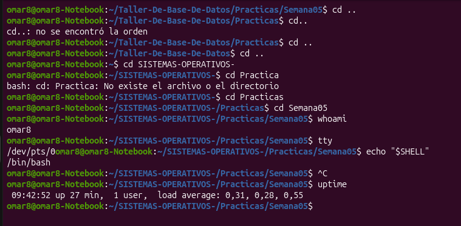
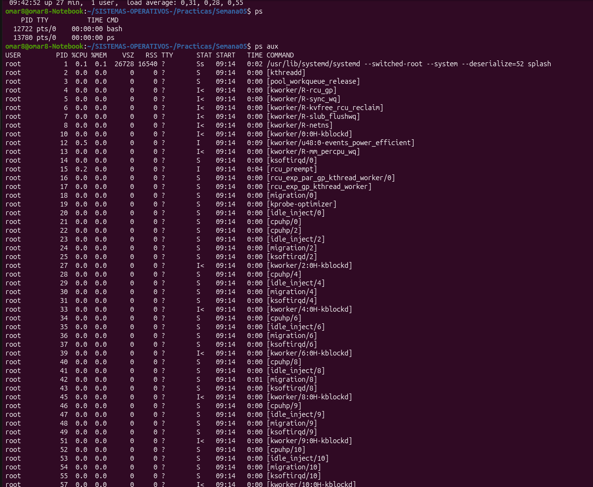
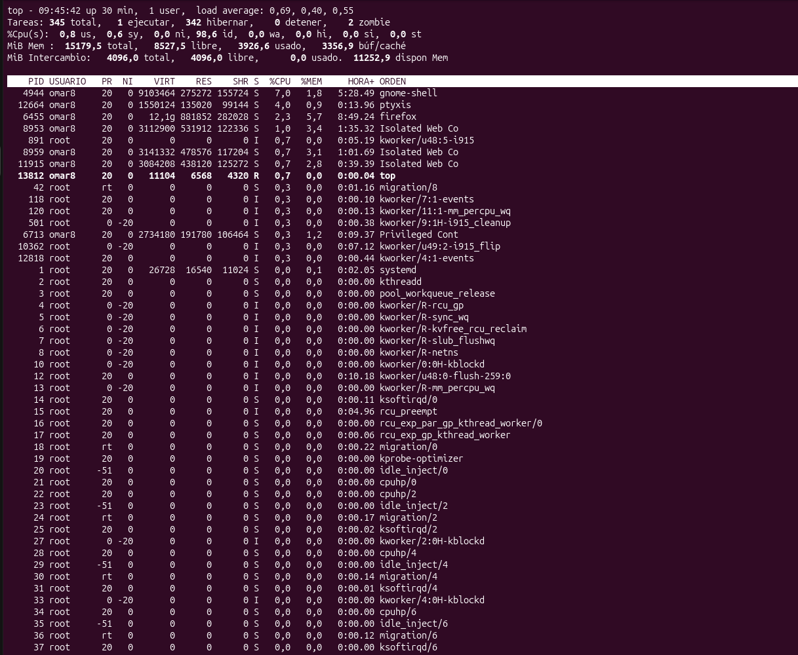
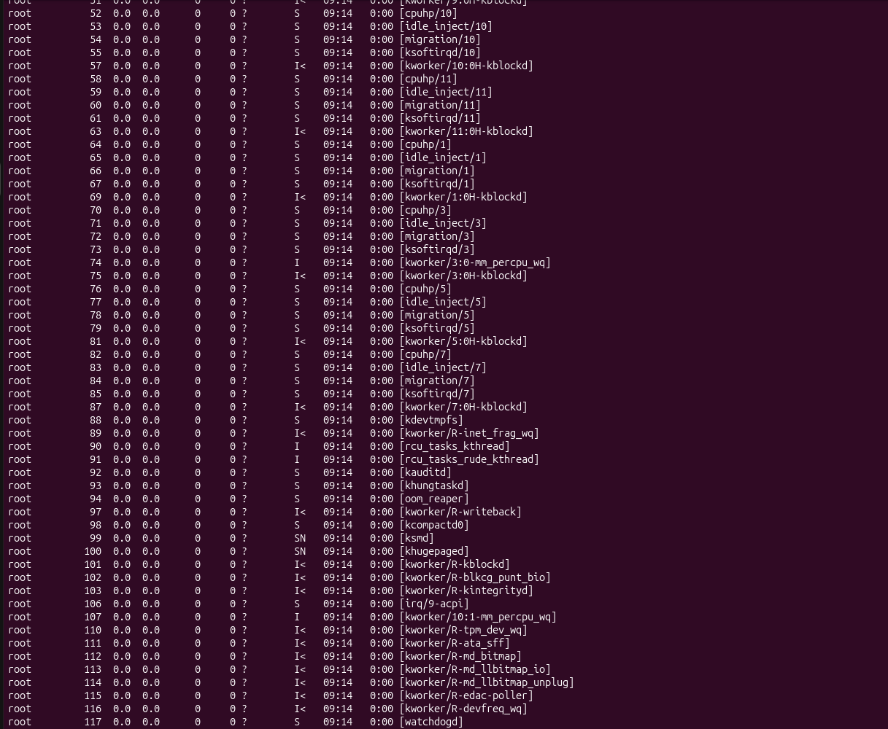
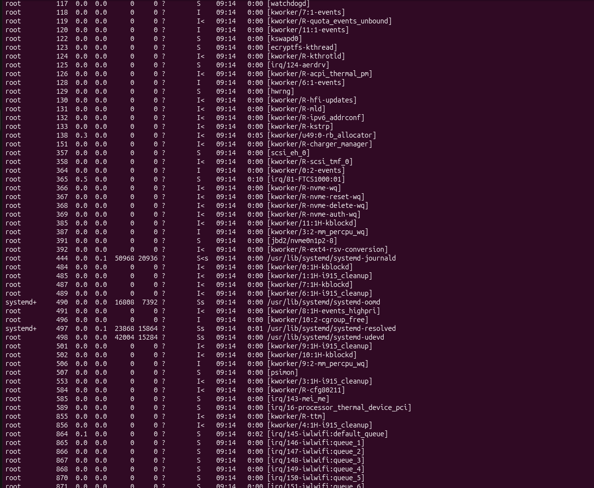
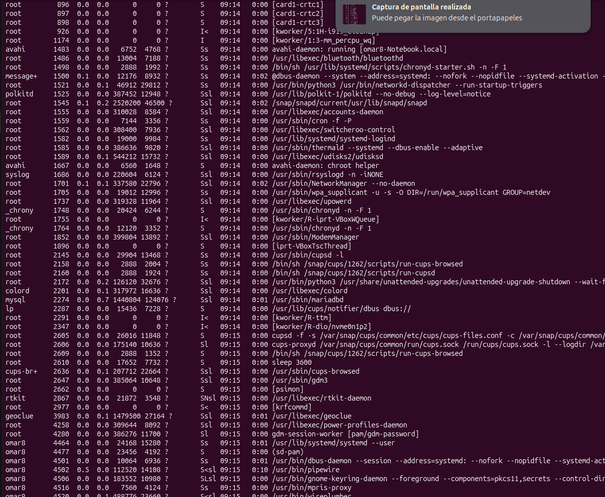
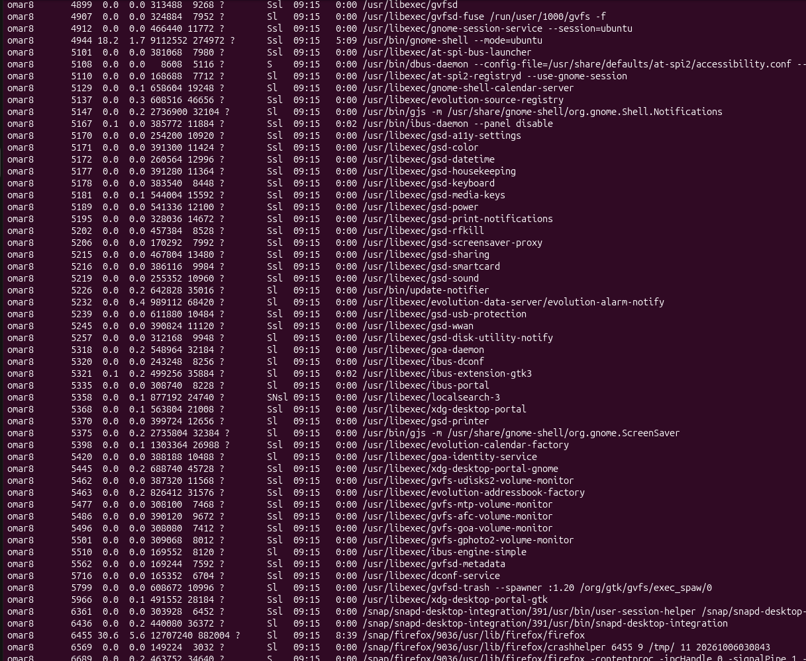
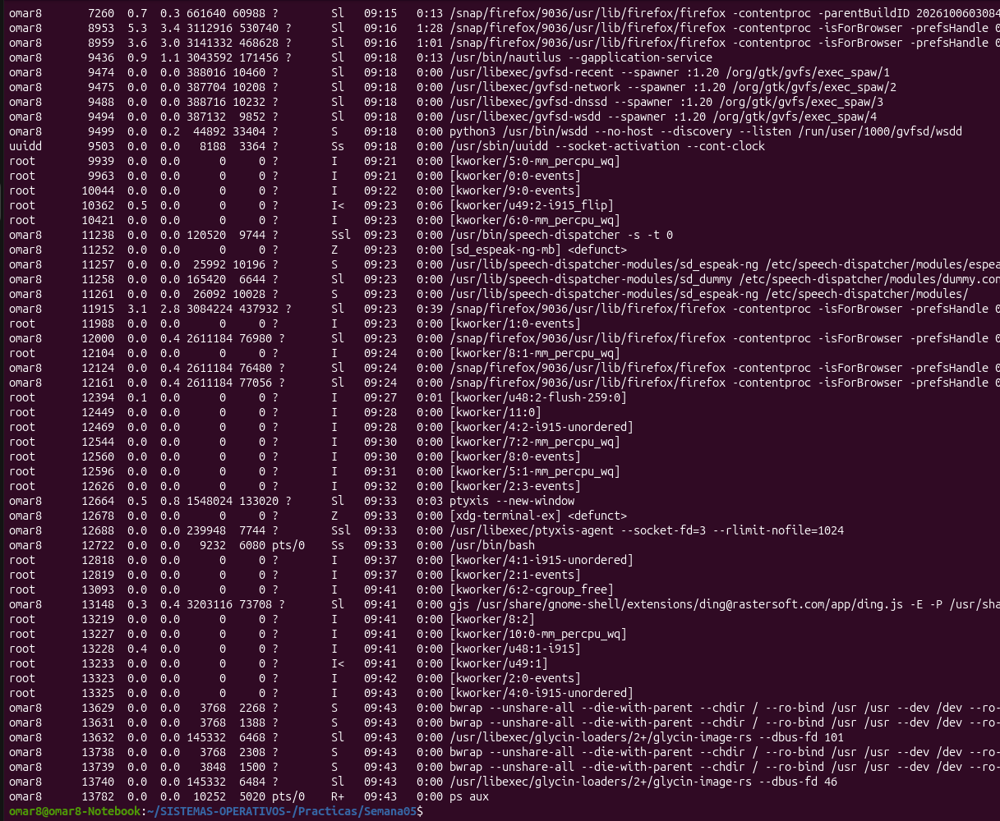

# 🟣 Informe Técnico — Práctica 05: Procesos en Ubuntu

**Alumno:** Omar Said Duarte Ruiz 
**Materia:** Sistemas Operativos 
**Entorno:** Ubuntu Linux (`omar8@omar8-Notebook`) 

---

## 1. 🎬 El problema planteado
En el entorno de laboratorio se plantea la duda común de si una computadora se vuelve lenta únicamente por tener *"demasiados programas abiertos"*. El objetivo es diagnosticar y verificar el estado del sistema desde la terminal observando la diferencia entre programas y procesos, identificando identificadores de proceso (PID y PPID), evaluando sus estados de ejecución, manipulando trabajos en primer y segundo plano, ajustando prioridades (`nice`) y aplicando mecanismos de terminación segura con señales (`SIGTERM`).

---

## 2. 🧰 Comandos utilizados y por qué se eligieron

| Comando | ¿Por qué se eligió? |
|---|---|
| `whoami`, `tty`, `echo "$SHELL"` | Para validar el usuario activo (`omar8`), la terminal asociada (`/dev/pts/0`) y el shell (`/bin/bash`). |
| `uptime` | Para consultar el tiempo encendido del equipo y los promedios de carga promedio. |
| `ps` | Para listar únicamente los procesos vinculados a la terminal actual. |
| `ps aux` | Para tomar una instantánea completa de los procesos de todos los usuarios del sistema con métricas detalladas (`%CPU`, `%MEM`, `STAT`). |
| `top` | Para monitorear en tiempo real y de forma dinámica el consumo de recursos de los procesos. |
| `sleep 300 &` | Para crear un proceso inofensivo que simula una tarea en segundo plano durante 5 minutos sin bloquear la terminal. |
| `jobs -l` | Para listar los trabajos controlados por la sesión de shell actual junto con sus PID. |
| `nice -n 10` | Para iniciar un proceso especificando una menor prioridad relativa frente al planificador de la CPU. |
| `kill -TERM` | Para enviar una señal de terminación ordenada (`SIGTERM`) a un PID específico evitando el uso de comandos masivos destructivos. |

---

## 3. 🆔 Ejemplo de PID y PPID obtenido en el equipo

Al consultar los procesos desde la terminal se obtuvo el siguiente ejemplo real de jerarquía proceso hijo - proceso padre:

* **Proceso examinado:** `ps aux` (o consulta en terminal)
* **PID del proceso (Hijo):** `13782` (comando `ps aux`)
* **PPID (Proceso Padre):** `12722` (correspondiente a la shell `/bin/bash` ejecutándose en la terminal `pts/0`)

*Interpretación:* La terminal interactiva `bash` (PPID `12722`) creó y ejecutó la nueva instancia del comando `ps` (PID `13782`).

---

## 4. 🔍 Interpretación de un estado real observado

En la salida del comando `ps aux` se observaron múltiples procesos con la letra de estado **`S`** (por ejemplo, `mysqld` con PID `2274` o `avahi-daemon` con PID `1483`):

* **Estado observado:** `S` (*Interruptible sleep* / Espera interrumpible).
* **Interpretación:** Un proceso en estado `S` no está fallando ni consumiendo CPU activamente; se encuentra en espera de un evento, entrada del usuario o señal del sistema para volver a la cola de ejecución. Es el estado en el que permanecen la mayoría de los servicios en un sistema Linux saludable.

---

## 5. 🔄 Diferencia entre primer plano y segundo plano

* **Primer plano (*Foreground*):** El proceso se vincula directamente a la entrada/salida de la terminal. Mientras el programa corre (por ejemplo, `sleep 60`), la terminal queda bloqueada y no permite escribir otros comandos hasta que el trabajo finalice o se suspenda.
* **Segundo plano (*Background*):** Al añadir el símbolo `&` al final del comando (`sleep 300 &`), el trabajo se ejecuta de forma independiente liberando la línea de comandos de la terminal para continuar trabajando sin interrupciones.

---

## 6. ⚡ Diferencia entre `Ctrl+C`, `Ctrl+Z` y `kill -TERM`

| Acción / Comando | Señal enviada | Efecto en el proceso |
|---|---|---|
| **`Ctrl+C`** | `SIGINT` (Interrupción) | Cancela e interrumpe inmediatamente la ejecución del trabajo que se encuentra en primer plano. |
| **`Ctrl+Z`** | `SIGTSTP` (Parada por terminal) | **Suspende** (detiene) el trabajo en primer plano y lo manda al fondo sin terminarlo, permitiendo reanudarlo con `bg` o `fg`. |
| **`kill -TERM PID`** | `SIGTERM` (Terminación) | Solicita a un proceso específico (por su PID) que finalice de manera ordenada, permitiéndole liberar recursos y cerrar archivos correctamente. |

---

## 7. 🎚️ Comparación del valor `NI` (Nice)

Al ejecutar procesos controlados con `nice`:
* Un proceso normal se inicia por defecto con un valor `NI` de **`0`**.
* Al ejecutar `nice -n 10 sleep 300 &`, el proceso recibe un valor `NI` de **`10`**.
* **Efecto:** Un valor `NI` más alto (más "agradable" con otros procesos) le indica al planificador del kernel que le otorgue una menor prioridad de uso de CPU en caso de que otros procesos compitan por recursos de cómputo.

---

## 📸 Evidencias descritas

Figura 1: Verificación de sesión de usuario (`whoami`), terminal asociada (`tty`), shell activo (`SHELL`) y tiempo encendido del equipo junto a la carga promedio (`uptime`).

Figura 2: Consulta inicial de procesos de la terminal actual con `ps` y primera sección del listado general de procesos del sistema con `ps aux` mostrando PID 1 (`systemd`).

Figura 3: Monitoreo dinámico en tiempo real con `top`, mostrando el uso global de CPU (98.6% idle), consumo de memoria RAM y la tabla ordenada de procesos activos.

Figura 4: Continuación del listado `ps aux` mostrando subprocesos del kernel como controladores de hilos de interrupción (`ksoftirqd`), tareas de migración y monitoreo de CPU.

Figura 5: Vista de procesos de segundo plano del sistema, incluyendo demonios de journaling (`systemd-journald`), resolución de red (`systemd-resolved`) y gestores de dispositivos.

Figura 6: Listado de servicios del sistema e infraestructura gráfica, incluyendo `snapd`, `NetworkManager`, servidor de bases de datos `mariadb` y procesos de la sesión de usuario.

Figura 7: Detalle de procesos pertenecientes al entorno de escritorio del usuario `omar8`, incluyendo el compositor gráfico `gnome-shell`, extensiones y servicios de segundo plano.

Figura 8: Parte final del listado `ps aux`, donde se identifican procesos del navegador `firefox`, la shell interactiva `bash` (PID 12722) y el proceso final de la propia consulta `ps aux` (PID 13782).
---

## 9. 💡 Conclusión técnica

Se comprobó que la cantidad de programas abiertos no es un indicador directo de la lentitud de un equipo, ya que la mayoría de los procesos permanecen en estado de espera (`S`) sin saturar la CPU. Comprender la relación entre PID y PPID, dominar el control de trabajos en segundo plano y aplicar terminaciones seguras con `kill -TERM` evita el uso indiscriminado de comandos peligrosos como `pkill` o `kill -9`, garantizando una administración eficiente y segura del sistema operativo Ubuntu.
